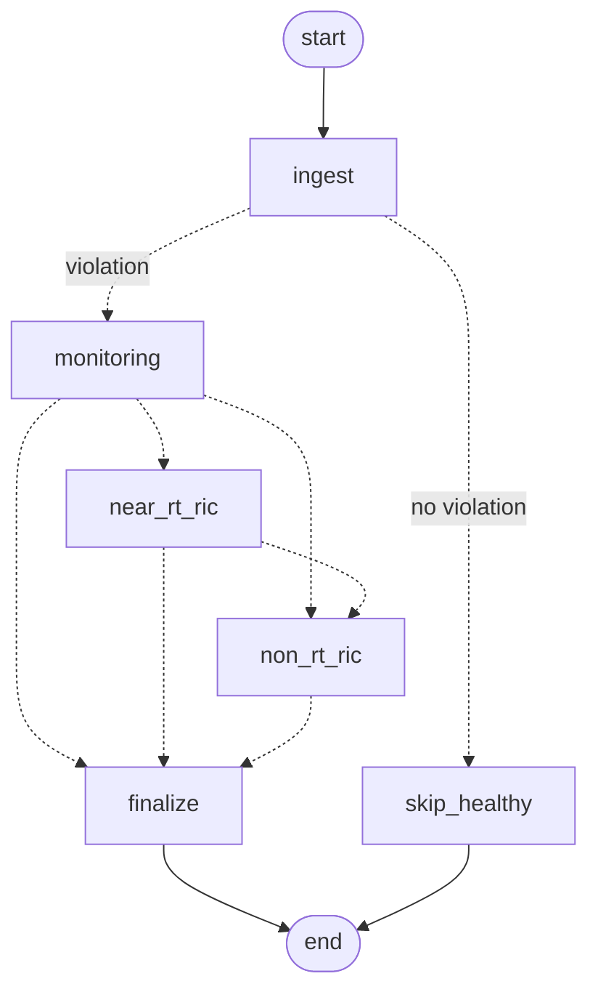

# Agentic AI for 6G Networks — Agentic O-RAN Management PoC

## Overview

This project is a research Proof of Concept (PoC) for **Agentic AI in 6G Networks**, with a particular focus on autonomous and governed network management.

The objective is **not to implement a complete 6G or O-RAN network**. Instead, the PoC focuses on the design and implementation of an **agentic system capable of observing network conditions, reasoning about them, selecting specialized agents, proposing actions, and validating those actions through a dedicated governance layer**.

The telemetry comes from a **RAN emulator** that replays real-stack ColO-RAN traces: each 1 s step produces one record per cell and slice, as a monitoring system would. The agents' approved actions are executed on that emulator through **MCP tool servers**, so the next records show their effect (see [Closed loop: RAN emulator, MCP tools and tool calling](#closed-loop-ran-emulator-mcp-tools-and-tool-calling)).

The core research question is:

> **How can a multi-agent AI system autonomously reason about network conditions, delegate decisions to specialized RIC agents, and ensure that proposed network actions remain subject to explicit trust, policy, SLA, and safety constraints?**

The PoC implements four cooperating agents:

1. **Monitoring Agent — Orchestrator**
2. **Near-RT RIC Agent**
3. **Non-RT RIC Agent**
4. **RAN Trust & Governance Agent**

The architecture intentionally separates **reasoning**, **specialized decision making**, and **deterministic governance**.

---

# 1. Research Objective

The primary objective is to demonstrate an **agentic decision-making architecture for autonomous RAN management**.

The system is designed around the following conceptual pipeline:

```text
Network Telemetry
       │
       ▼
Monitoring Agent
       │
       │  Situation understanding
       │  SLA interpretation
       │  Agent selection
       ▼
RIC Agent
       │
       │  Action reasoning
       │  Action proposal
       ▼
Trust & Governance Agent
       │
       │  Validation
       │  Policy
       │  Trust
       │  SLA
       │  Safety
       ▼
Approved / Rejected
```

An approved action is then **executed on an emulated RAN**, not on a real one: the RAN emulator replays real ColO-RAN traces and switches to the trace recorded with the new configuration (or applies a modelled effect), so the next telemetry shows the result, and the system checks whether the action fixed the violation.

This keeps the research focused on the agentic mechanisms and their governance, while closing the loop, without requiring a real O-RAN deployment.

---

# 2. Architectural Principles

The architecture follows several fundamental principles.

## 2.1 Centralized orchestration

The **Monitoring Agent is the entry point of the system**.

It is the only component that receives the incoming telemetry records.

It is responsible for determining:

- what is happening;
- whether the network situation requires intervention;
- how severe the situation is;
- which specialized agent should handle it;
- whether Near-RT RIC, Non-RT RIC, both, or neither should be invoked.

The Monitoring Agent does **not** directly execute network actions.

---

## 2.2 Specialized agents

The system separates RAN reasoning according to the temporal and operational responsibilities traditionally associated with Near-RT and Non-RT RIC functions.

The **Near-RT RIC Agent** handles short-term and relatively rapid decisions.

The **Non-RT RIC Agent** handles higher-level and longer-term decisions.

This separation is important because the goal is not to create one large general-purpose network agent.

Instead, the architecture demonstrates **specialized autonomous agents coordinated by an orchestrator**.

---

## 2.3 Governance as an interception layer

RIC agents are allowed to reason about potential actions, but they cannot simply declare an action executable.

Every protected action must pass through the **RAN Trust & Governance Agent**.

Therefore:

```text
RIC Agent
   │
   │ Proposed Action
   ▼
Trust & Governance
   │
   ├── Schema validation
   ├── Policy validation
   ├── Trust/Security validation
   ├── SLA validation
   └── Resource/Safety validation
   │
   ▼
Approved / Rejected
```

The governance layer acts as a **control boundary between AI-generated decisions and potential network operations**.

This is one of the central principles of the PoC.

---

# 3. The Four-Agent System

## 3.1 Monitoring Agent

The Monitoring Agent is the **main orchestrator**.

It receives one telemetry record at a time and transforms that raw observation into a structured decision.

Its responsibilities are:

- interpreting incoming telemetry;
- understanding the current network/slice situation;
- evaluating SLA conditions;
- identifying relevant degradation;
- considering recent observations through working memory;
- determining severity;
- deciding whether intervention is necessary;
- selecting the appropriate RIC agent;
- explaining the decision at a high level.

The Monitoring Agent can produce four routing outcomes:

```text
No intervention
Near-RT RIC
Non-RT RIC
Both RIC agents
```

The important distinction is that the Monitoring Agent **does not implement the RAN optimization itself**.

It decides **who should reason about the problem**.

---

## 3.2 Near-RT RIC Agent

The Near-RT RIC Agent represents an autonomous agent responsible for relatively fast RAN decisions.

Its conceptual responsibilities include:

- short-term resource optimization;
- rapid mitigation of degradation;
- radio/resource adjustments;
- local optimization.

In the PoC, these are represented as **agentic action proposals** rather than real RAN operations.

For example, the agent could reason that a slice experiencing high latency should receive additional resources and generate a structured proposal such as:

```text
Target:
    ran_slice

Action:
    resource_reallocation

Parameters:
    resource = PRB
    direction = increase

Expected effect:
    reduce_latency
```

The important research aspect is not the physical PRB modification.

The important aspect is that an autonomous agent:

1. receives a structured objective;
2. reasons about a possible intervention;
3. generates a machine-readable action;
4. submits that action to governance.

---

## 3.3 Non-RT RIC Agent

The Non-RT RIC Agent represents a higher-level optimization agent.

Its responsibilities include:

- policy-level optimization;
- longer-term resource planning;
- persistent degradation analysis;
- higher-level RAN configuration decisions.

The Non-RT RIC Agent receives a structured request from the Monitoring Agent.

It then reasons about the problem and generates a proposed action.

As with the Near-RT RIC Agent, the proposal is **not directly executable**.

It must pass through the Trust & Governance Agent.

---

## 3.4 RAN Trust & Governance Agent

The RAN Trust & Governance Agent provides the safety and governance boundary for the system.

It receives:

- the proposed action;
- the relevant context;
- the originating RIC agent;
- applicable policy information;
- SLA information;
- resource/safety constraints.

It does **not** independently consume the telemetry.

Its responsibility is to answer:

> **Is this proposed action allowed to proceed under the defined governance constraints?**

The validation pipeline is deterministic wherever possible:

```text
Proposed Action
      │
      ▼
Action Schema Validation
      │
      ▼
Policy / Trust Validation
      │
      ▼
SLA Validation
      │
      ▼
Resource / Safety Validation
      │
      ▼
Approved / Rejected
```

A rejected action must never be considered executable.

---

# 4. Agent Interaction Model

The complete agentic interaction is:

```text
Telemetry Record
       │
       ▼
Monitoring Agent
       │
       ├──────────────► No Intervention
       │
       ├──────────────► Near-RT RIC Agent
       │                       │
       │                       ▼
       │                Proposed Action
       │                       │
       │                       ▼
       │              Trust & Governance
       │                       │
       │                       ▼
       │                Approved / Rejected
       │
       ├──────────────► Non-RT RIC Agent
       │                       │
       │                       ▼
       │                Proposed Action
       │                       │
       │                       ▼
       │              Trust & Governance
       │                       │
       │                       ▼
       │                Approved / Rejected
       │
       └──────────────► Both
```

A fundamental architectural constraint is:

```text
Monitoring Agent
       │
       ├── Near-RT RIC
       │       └── Trust & Governance
       │
       └── Non-RT RIC
               └── Trust & Governance
```

There is no:

```text
Monitoring Agent → Trust & Governance
```

and no:

```text
RIC Agent → Dataset
```

The RIC agents operate on the **structured context supplied by the Monitoring Agent**, not on the original telemetry stream.

This preserves the separation of responsibilities defined by the architecture.

---

# 5. Telemetry as the Agentic Input

The telemetry comes from the **RAN emulator** (`ran_emulator/`), which replays the **ColO-RAN** dataset (real srsRAN stack on the Colosseum emulator: 7 base stations, 3 slices each, 3 schedulers x 28 PRB splits). `scripts/prepare_coloran.py` aggregates the per-UE KPM reports (every 250 ms) into one `TelemetryRecord` per **base station, slice and 1 s window**, in native units; the emulator emits records in exactly that schema, one per cell and slice at every step (`src/schema/monitoring.py`):

| Group | Fields |
|---|---|
| Identity | `record_id`, `cell_id`, `slice_id` (eMBB / MTC / URLLC), `run` (source configuration), `window_start_s`, `window_s` |
| Configuration | `slice_prb` (of `cell_prb` = 50), `scheduler` |
| Measurements | `active_ues`, `dl_throughput_mbps`, `dl_throughput_per_ue_mbps`, `dl_buffer_bytes`, `queueing_delay_ms`, `prb_utilisation`, `cell_spare_prb`, `dl_cqi`, `dl_mcs`, `ul_sinr_db` |

`scripts/explore_coloran.py` documents why these fields were chosen (columns that never change, redundant counters, the start-up window). The records of a step are processed sequentially; an action changes the records of the following steps.

---

# 6. Deterministic SLA Evaluation

Numerical SLA comparisons are not delegated to the LLM. The records carry measurements only; the SLA profile of each slice type lives in `src/schema/sla.py` and is evaluated at runtime by `MonitoringAgent.analyze_sla`:

| Slice | throughput per UE (min) | queueing delay (max) |
|---|---|---|
| eMBB | 3.6 Mbps (90 % of the 4 Mbps CBR load) | 100 ms |
| MTC | 0.015 Mbps | 100 ms |
| URLLC | 0.005 Mbps | 10 ms |

The result (`SLAAnalysis`) lists every KPI with its measured value, budget, unit and bound, plus the violated and unavailable KPIs. The LLM reasons over it and never recomputes it. PRB utilisation and spare PRBs are context, not SLA terms.

---

# 7. Agentic Reasoning

The system should not be implemented as a collection of fixed `if/else` rules.

The deterministic components establish **facts and constraints**.

The LLM provides the **reasoning and orchestration layer**.

For example, deterministic tools may determine:

```text
Latency violation = true
Throughput violation = true
Packet loss violation = false
```

The Monitoring Agent then reasons about:

```text
What is the current situation?

How severe is it?

Does it require intervention?

Which specialized agent should handle it?

Should both short-term and long-term optimization be considered?

Why?
```

The output is converted into a strongly typed decision.

This allows the system to demonstrate genuine agentic behavior while retaining deterministic control over safety-critical logic.

---

# 8. Structured Agent Communication

Agents communicate using strongly typed Pydantic models rather than unstructured natural-language messages.

Important conceptual objects include:

```text
TelemetryRecord      (src/schema/monitoring.py)
MonitoringDecision   (src/schema/monitoring.py)
AgentInvocation      (src/schema/monitoring.py)
RANActionProposal    (src/schema/near_rt_ric.py)
GovernanceResult     (src/schema/near_rt_ric.py)
```

For example, the Monitoring Agent may produce:

```json
{
  "situation": "critical",
  "sla_violations": ["latency", "throughput"],
  "severity": "high",
  "selected_agents": ["near_rt_ric", "non_rt_ric"],
  "action_required": true,
  "reason": "The slice is experiencing significant SLA degradation requiring immediate mitigation and longer-term optimization."
}
```

The exact schemas can evolve as the research progresses, but the principle remains:

> **Agent-to-agent communication should be machine-readable, validated, and explicit.**

This makes the system easier to test and prevents free-form LLM output from becoming an uncontrolled interface between agents.

---

# 9. Proposed Actions

RIC agents do not return arbitrary textual recommendations: they call **typed action tools**, and each call becomes a structured proposal for governance.

A call has the tool's own arguments plus the agent's justification:

```json
{
  "tool": "adjust_prb_allocation",
  "arguments": {"target": "bs2", "slice_id": "eMBB", "prb_percentage": 72},
  "rationale": "eMBB throughput 2.7 Mbps/UE is below its 3.6 budget and delay 500 ms is above 100 ms at 18 PRBs ...",
  "expected_effect": "Throughput per UE above 3.6 Mbps, delay below 100 ms.",
  "confidence": 0.8,
  "evidence_sources": ["slice_state.slice_prb_share_pct", "knowledge: PRB scaling"]
}
```

Governance adds the trusted invocation context (target, slice, SLA analysis, persistence, controls in force) to build the proposal it validates. The seven tools (PRB share, scheduler, handover margin, power offset, slice priority, link adaptation, slice policy) and how they act on the emulated RAN are described in [How a tool call works](#3-how-a-tool-call-works).

---

# 10. Trust and Governance

The Trust & Governance Agent converts an AI-generated proposal into a governed decision.

A governance result can conceptually contain:

```json
{
  "approved": true,
  "checks": {
    "schema": true,
    "policy": true,
    "trust": true,
    "sla": true,
    "resource_safety": true
  },
  "reason": "Action satisfies the defined governance constraints."
}
```

A rejected action could produce:

```json
{
  "approved": false,
  "checks": {
    "schema": true,
    "policy": false,
    "trust": true,
    "sla": true,
    "resource_safety": true
  },
  "reason": "The proposed action violates the configured policy."
}
```

The important property is:

```text
LLM proposes
     ↓
Governance validates
     ↓
System decides whether it is allowed
```

The LLM cannot bypass governance.

---

# 11. Deterministic Guardrails

The governance layer should use deterministic validation whenever possible.

The conceptual guardrail order is:

```text
1. Action Schema Validation
          ↓
2. Policy / Trust Validation
          ↓
3. SLA Validation
          ↓
4. Resource / Safety Validation
          ↓
5. Final Governance Decision
```

This allows the system to distinguish between:

- what the LLM **believes should happen**;
- what the system **allows to happen**.

That distinction is particularly important for an agentic networking architecture.

---

# 12. Working Memory

The PoC uses **working memory only**.

The purpose of working memory is to provide recent context to the agents.

It can contain:

```text
Recent telemetry observations
Recent SLA violations
Recent events
Previous decisions
Previously invoked agents
Recent proposed actions
Recent governance outcomes
```

For example:

```text
Observation 1
    latency degradation
    → Near-RT selected

Observation 2
    latency degradation persists
    → Near-RT + Non-RT selected

Observation 3
    governance rejected previous action
    → Monitoring Agent considers alternative
```

This enables the system to reason about **evolving network conditions**, rather than treating every telemetry record as completely independent.

The memory remains deliberately simple.

The PoC does not require:

- vector databases;
- semantic memory;
- knowledge graphs;
- long-term memory;
- complex distributed memory systems.

The memory interface should nevertheless be designed so that persistent memory can be introduced later without redesigning the agents.

---

# 13. LLM Abstraction

The agents communicate with models through **LiteLLM**.

The agents should not be tightly coupled to a specific model provider.

Conceptually:

```text
Agent
  │
  ▼
LLM Gateway
  │
  ├── OpenAI
  ├── Azure OpenAI
  ├── vLLM
  └── Other compatible models
```

The model is therefore an implementation detail of the agentic system.

This is important for research experimentation because different models can later be evaluated under the same agent architecture.

The PoC can therefore study questions such as:

- Does model selection affect agent routing?
- Does model capability affect action quality?
- How often does governance reject unsafe proposals?
- How consistent are decisions across models?
- How does working memory affect sequential decisions?

---

# 14. Agent State

Each agent should operate using structured state rather than relying exclusively on conversational text.

Conceptually, state can include:

```text
Current invocation
Current context
Relevant SLA analysis
Working memory
Agent decision
Proposed action
Governance outcome
```

The Monitoring Agent's state represents the orchestration context.

A RIC Agent's state represents the specialized decision context.

The Trust & Governance Agent's state represents the action-validation context.

This separation prevents unrelated information from being passed indiscriminately between agents.

---

# 15. Separation of Responsibilities

The architecture intentionally separates the system into four conceptual layers.

### Observation

```text
Telemetry
```

### Reasoning

```text
Monitoring Agent
RIC Agents
```

### Governance

```text
Trust & Governance Agent
```

### Execution

```text
Not implemented in the PoC
```

Therefore:

```text
Observation
    ↓
Reasoning
    ↓
Governance
    ↓
[Future Execution Layer]
```

This separation makes the PoC suitable as a foundation for later integration with real O-RAN infrastructure.

---

# 16. Execution Model

The PoC processes telemetry sequentially.

For each record:

```text
1. Read the next emulator step (one TelemetryRecord per cell and slice)
        ↓
2. Verify the slice's earlier actions that are now due
        ↓
3. Analyze deterministic SLA conditions
        ↓
4. Provide structured context to Monitoring Agent
        ↓
5. Monitoring Agent reasons about the situation
        ↓
6. Monitoring Agent selects zero, one, or two RIC agents
        ↓
7. Selected RIC agent receives a structured request
        ↓
8. RIC agent reasons about a possible action
        ↓
9. RIC agent calls an action tool (a structured proposal)
        ↓
10. The call enters governance
        ↓
11. Governance validates the action
        ↓
12. Approved: executed on the emulator through MCP; rejected: the agent gets the reason
        ↓
13. Result is recorded
        ↓
14. Working memory is updated; the action is queued for verification
```

The process is then repeated for the next observation.

This provides a simple but complete agentic loop.

Since v3.3 the workflow of one record is a LangGraph `StateGraph`
([agents/record_workflow.py](agents/record_workflow.py)). Its state is shared
by the nodes of that record only; Redis keeps the memory across records and
MongoDB the results. The diagram below is generated by
`RecordWorkflow.draw_mermaid()`:



| Node | Does | Writes |
|---|---|---|
| `ingest` | SLA analysis, base-station configuration, persistence, verification of the slice's due actions | Redis meta + persistence + outcomes; MongoDB record (on a violation) and action outcomes |
| `skip_healthy` | no violation: no LLM call | Redis slice history; run counter |
| `monitoring` | LLM decision + deterministic routing rules | MongoDB `monitoring`; Redis cell/slice history |
| `near_rt_ric`, `non_rt_ric` | the selected RIC agents, Near-RT first, with the trusted context built from the state; approved tool calls run on the emulator | MongoDB `agents.<agent>`; Redis actions, controls in force, pending verifications |
| `finalize` | closes the record | MongoDB status + run counters |

One graph run per record is one LangSmith trace (`record <record_id>`, with
the run, record, cell and slice as metadata) when `LANGSMITH_TRACING=true`.

---

# 17. Example End-to-End Scenario

Consider a telemetry record indicating that:

```text
Latency:
    above budget

Throughput:
    below required rate

Packet loss:
    within budget
```

The deterministic SLA component returns:

```text
Latency violation = true
Throughput violation = true
Packet loss violation = false
```

The Monitoring Agent receives these facts and reasons that the slice is experiencing significant degradation.

It may produce:

```text
Situation:
    SLA degradation

Severity:
    High

Action required:
    True

Selected agents:
    Near-RT RIC
    Non-RT RIC
```

The Near-RT RIC Agent may propose an immediate resource adjustment.

The Non-RT RIC Agent may propose a longer-term optimization.

Each proposal is independently sent through governance.

The final result could therefore be:

```text
Monitoring
    ├── Near-RT RIC
    │       └── Action A
    │              └── Governance → APPROVED
    │
    └── Non-RT RIC
            └── Action B
                   └── Governance → REJECTED
```

The system therefore demonstrates that **agent selection, action generation, and action authorization are independent decisions**.

---

# 18. Observability

The PoC should provide a clear execution trace.

A typical execution should be understandable from logs such as:

```text
Record: 00042

Monitoring Agent
    Situation: SLA degradation
    Violations: latency, throughput
    Severity: high
    Selected agents:
        - near_rt_ric
        - non_rt_ric

Near-RT RIC
    Proposed action: resource_reallocation

Trust & Governance
    Result: APPROVED

Non-RT RIC
    Proposed action: policy_adjustment

Trust & Governance
    Result: REJECTED
```

The logs should expose:

- agent invocation;
- structured inputs;
- structured outputs;
- selected agents;
- proposed actions;
- governance decisions;
- execution outcomes.

They should **not expose private chain-of-thought**.

Only concise explanations and structured decision information should be logged.

---

# 19. Research-Oriented Evaluation

The architecture makes it possible to evaluate the agentic system independently from a real RAN.

Potential evaluation dimensions include:

### Monitoring decisions

Measure:

- correctness of agent selection;
- correctness of intervention decisions;
- severity classification;
- consistency of decisions.

### RIC decisions

Measure:

- action validity;
- action relevance;
- alignment with the Monitoring Agent request;
- structured-output validity.

### Governance

Measure:

- percentage of actions approved;
- percentage rejected;
- reasons for rejection;
- policy violations;
- invalid actions detected.

### End-to-end behavior

Measure:

```text
Telemetry
   ↓
Monitoring
   ↓
Agent Selection
   ↓
Action Proposal
   ↓
Governance
   ↓
Final Decision
```

The emulated network therefore becomes an evaluation environment for the **agentic architecture**, rather than an attempt to benchmark actual 6G network performance. Because actions change the next records, the evaluation also measures whether the executed actions fixed the violations (`closed_loop` in `metrics.json`).

---

# 20. What the PoC Does Not Implement

The prototype controls an **emulated** RAN, not a real one. It does not implement:

- real O-RAN interfaces (E2, A1, O1): the MCP servers play their role (`near_rt` ≈ E2 controls, `non_rt` ≈ A1 policies);
- real xApps or rApps, or a real RIC platform (FlexRIC, OSC);
- a real RAN deployment or real-time radio control;
- live radio effects: PRB splits and schedulers switch to traces recorded on a real stack (ColO-RAN), while power, handover, link adaptation and priority effects are modelled (`ran_emulator/overlay.py`).

This keeps the research focused on the **agentic intelligence and governance architecture**. A real network can later replace the emulator behind the same MCP tools.

---

# 21. Future Integration

The PoC now runs the full loop on the emulator:

```text
Proposed Action → Governance → MCP tools → RAN emulator → Telemetry → Monitoring Agent
```

and is designed so that the emulator can later be replaced by a real network behind the same tools:

```text
Proposed Action → Governance → MCP tools → O-RAN Control Interface (E2 / A1) → Real Network → Telemetry
```

This creates a closed autonomous control loop:

```text
Observe
   ↓
Reason
   ↓
Delegate
   ↓
Propose
   ↓
Govern
   ↓
Execute
   ↓
Observe Again
```

The current PoC implements all of these stages on an emulated RAN, and adds a deterministic verification of every executed action on the next telemetry record.

---

# 22. Core Design Principle

The central principle of this research prototype is:

> **AI agents can reason about network conditions and propose autonomous actions, but network actions must remain subject to explicit deterministic governance.**

The resulting architecture can be summarized as:

```text
                    ┌─────────────────────┐
                    │   Network Telemetry │
                    └──────────┬──────────┘
                               │
                               ▼
                    ┌─────────────────────┐
                    │  Monitoring Agent   │
                    │    Orchestrator     │
                    └──────────┬──────────┘
                               │
                  ┌────────────┴────────────┐
                  │                         │
                  ▼                         ▼
        ┌──────────────────┐       ┌──────────────────┐
        │ Near-RT RIC      │       │ Non-RT RIC       │
        │ Agent            │       │ Agent            │
        └────────┬─────────┘       └────────┬─────────┘
                 │                          │
                 └────────────┬─────────────┘
                              ▼
                 ┌─────────────────────────┐
                 │ RAN Trust & Governance  │
                 │         Agent           │
                 └────────────┬────────────┘
                              │
                    ┌─────────┴─────────┐
                    │                   │
                 APPROVED             REJECTED
                    │
                    ▼
             MCP tools (via LiteLLM)
                    │
                    ▼
       RAN emulator → next telemetry
```

The PoC therefore provides a **minimal but research-oriented foundation for Agentic AI in autonomous 6G/O-RAN management**.

Its contribution at this stage is the **agentic architecture, inter-agent coordination, structured decision making, working memory, action generation, and trust-aware governance**, rather than implementation of the underlying 6G network functions. 17. Running the PoC

The runtime lifecycle is intentionally simple.

17.1 Start Redis

Redis must be running before starting the agentic system because it provides the working-memory backend.

On a Linux system using the Redis service:

sudo systemctl start redis-server

Verify that Redis is available:

redis-cli ping

Expected result:

PONG

If Redis is already configured to start automatically, only the verification step is necessary.

17.2 Start MongoDB

MongoDB provides persistent storage for agent execution information and results.

Start the MongoDB service:

sudo systemctl start mongod

Verify that MongoDB is running:

sudo systemctl status mongod

A successful installation should show the service as:

active (running)

MongoDB can also be checked directly with:

mongosh

and then:

db.runCommand({ ping: 1 })

The expected response contains:

ok: 1

18. Run Tests

The test suite should be executed before running the closed loop. It needs no external service: the model is scripted, Redis and MongoDB are faked, and the emulator and MCP servers run in process.

For a Poetry-based environment:

poetry run pytest

or, if the project is already inside the Poetry environment:

pytest

The tests should cover at least:

SLA calculations
Pydantic schemas
Working memory
Redis persistence
MongoDB persistence
Governance rules
Agent routing
Invalid actions
Approved actions
Rejected actions
Agent-to-agent communication

The most important integration test should validate the complete workflow:

Telemetry
↓
Monitoring Agent
↓
Agent Selection
↓
RIC Agent
↓
Proposed Action
↓
Trust & Governance
↓
Approved / Rejected
↓
Persistence

LLM calls should be mocked during unit and integration tests whenever possible.

This ensures that tests validate the agentic system rather than network availability or model-provider availability.

19. Run the Closed Loop

After Redis and MongoDB are available and the tests pass, start the stack and run a few emulator steps
(see "Closed loop on the RAN emulator" below):

./scripts/start_stack.sh
poetry run python scripts/run_loop.py --scenario embb_prb_starvation --steps 10

The execution should:

Read each step's telemetry from the RAN emulator.

Process records sequentially.

Send each record to the Monitoring Agent.

Let the Monitoring Agent determine the required intervention.

Invoke the selected RIC agents.

Generate structured proposed actions.

Pass protected actions through Trust & Governance.

Record tool executions and decisions.

Update Redis working memory.

Persist relevant execution information in MongoDB.

Once a short run is validated, run longer episodes (`--steps`) and the other scenarios.

20. Recommended Run Sequence

The complete development workflow is:

Start Redis
↓
Verify Redis
↓
Start MongoDB
↓
Verify MongoDB
↓
Run Tests
↓
Start the stack (emulator, MCP servers, LiteLLM)
↓
Run a short episode (a few steps)
↓
Inspect Agent Trace
↓
Inspect Redis Working Memory
↓
Inspect MongoDB Execution Records
↓
Run longer episodes and the other scenarios

In command form:

sudo systemctl start redis-server
redis-cli ping

sudo systemctl start mongod
sudo systemctl status mongod

poetry run pytest

./scripts/start_stack.sh
poetry run python scripts/run_loop.py --scenario embb_prb_starvation --steps 10


# v2 corrections

See `CHANGES.md` for the list of fixes (role binding, Non-RT persistence gate, per-(cell, slice) persistence, optional `Cell ID`, bounded working memory, audit fix, prompt/test/path fixes) and the new end-to-end test; section v3 lists the fixes from the live-LLM runs (default-deny safety stage, schema alignment of the new tools, invocation limits, merged duplicate agent selections). Run `poetry run pytest` before `scripts/run_loop.py`; add `--debug` for verbose LangChain tracing.


# Using the ColO-RAN dataset (real-stack wireless traces)

The RAN emulator (`ran_emulator/`) replays **ColO-RAN** traces (Polese et al., IEEE TMC 2023): per-UE
traces collected with an srsRAN-based stack on the Colosseum emulator — 7 base stations, 3 slices
(eMBB, MTC, URLLC), 3 schedulers x 28 RBG splits. The preprocessing below builds the trace bank it
loads (without it, the emulator uses the tracked sample).

```bash
# 1. download (sparse clone, ~750 MB for one experiment run; GPL-3.0 data)
bash scripts/download_coloran.sh                       # -> data/raw/coloran (git-ignored)

# 2. convert to Monitoring-Agent telemetry (~5 min, 724,086 records)
poetry run python scripts/prepare_coloran.py           # -> data/coloran_prepared_dataset.csv (+ .summary.json)
#    options: --runs 50 (random subset of cell runs), --window 1.0 (s per record), --experiments exp1 exp2

# 3a. dry run without model / Redis / MongoDB / LiteLLM (scripted LLM, in-process emulator)
poetry run python scripts/demo_run_scripted.py 10 embb_prb_starvation

# 3b. real run (LLM and MCP via LiteLLM, Redis and MongoDB running)
./scripts/start_stack.sh
poetry run python scripts/run_loop.py --scenario embb_prb_starvation --steps 30
```

What one record is: one slice of one base station over a 1-s window.

| CSV column (TelemetryRecord) | ColO-RAN source |
|---|---|
| Slice Available Transfer Rate (Gbps) | sum of the slice UEs' DL rate (`tx_brate downlink`) |
| Slice Latency (ns) | mean queueing-delay estimate `dl_buffer * 8 / DL rate` (capped at 2 s) |
| Slice Jitter (ns) | standard deviation of that estimate in the window |
| Slice Packet Loss | mean DL transmission-error ratio (`tx_errors downlink (%)` / 100) |
| Slice Type / Use Case Type | eMBB, MTC, URLLC (slice 0/1/2) |
| Cell ID | base station (`bs1`..`bs7`) -> used as the governance target |
| budgets | fixed a priori per slice (see `BUDGETS` in `scripts/prepare_coloran.py`) |
| Violation labels | computed with `MonitoringAgent.analyze_sla` |

Records are ordered as a telemetry stream: per (scheduler, split, BS) run, by time, the three slices
interleaved. Each run starts when all three slices carry traffic (UE attach takes ~50 s).
Extra columns (`Scheduler`, `RBG Split`, `Run`, `Window Start (s)`) are ignored by the agents.


# Working memory and results store (v3.3)

**Redis is the agents' working memory**: network context for the next decision, keyed by base station and slice (`src/memory/working_memory.py`). Lists are capped with `LPUSH` + `LTRIM`, and every read or write is one pipeline.

| Key | Type | Content |
|---|---|---|
| `wm:cell:{cell}:meta` | HASH | configuration in force: run, scheduler, `prb:<slice>`, `util:<slice>` |
| `wm:cell:{cell}:records` / `wm:slice:{cell}:{slice}:records` | LIST | last records (KPIs, violations, severity, agents selected) |
| `wm:cell:{cell}:actions` / `wm:slice:{cell}:{slice}:actions` | LIST | last tool calls: tool, parameters, approved, executed, rejecting stage and deterministic reason |
| `wm:slice:{cell}:{slice}:persistence` | HASH | consecutive violated records per SLA KPI (Non-RT governance gate) |
| `wm:slice:{cell}:{slice}:controls` | HASH | PRB share and policy in force, as the RAN applied them (governance conflict check) |
| `wm:slice:{cell}:{slice}:pending` | LIST | executed actions waiting for their verification step |
| `wm:slice:{cell}:{slice}:outcomes` | LIST | verified outcomes of the last actions (`slice_outcomes` in the agents' view) |
| `wm:cells` | SET | cells seen (used by `reset`) |

Only facts are stored, never LLM rationales. A record from a new configuration of a base station (a new emulator episode) clears that base station's memory; an action inside an episode does not.

**MongoDB is the results store** (`src/repositories/mongo_repository.py`): `runs` has one small document per run (configuration and counters), and `records` has one document per telemetry record (telemetry, SLA analysis, persistence, the Monitoring decision, and each RIC agent's tool calls with their governance outcome). Each agent step adds to the record with a targeted `$set` / `$push`; documents are never re-written whole.


# Closed loop: RAN emulator, MCP tools and tool calling

The agents act on a network and watch it react. The network is the **RAN emulator**
(`ran_emulator/`), which replays real ColO-RAN traces. The agents change it through **RAN action
tools** served by **MCP servers** (`ric_tools/`) and reached through the **LiteLLM gateway**. Every
tool call passes **governance** before it reaches the network, and every executed action is
**verified** on the next telemetry record.

```text
scripts/run_loop.py  (one emulator step at a time; the emulator waits for the agents)
   │  EmulatorClient.step_records(): one TelemetryRecord per cell and slice
   ▼
record workflow:  ingest (SLA, persistence, verification) → Monitoring → Near-RT RIC → Non-RT RIC → finalize
                                                               │ the model calls a tool
                                       RANAuthorizationMiddleware → Trust & Governance (5 stages)
                                                               │ approved calls only
                              ric_tools/client.py ── MCP over HTTP, LiteLLM key ──▶ LiteLLM :4000
                                                                                     /near_rt/mcp  /non_rt/mcp
                                                                                        │
                                             MCP servers (ric_tools):  near_rt :8201   non_rt :8202
                                                                                        │ EmulatorClient
                                                                              RAN emulator :8100
                                                                                        │ next step
                                                                    the change shows in the next records
```

| Service | Port | Started by |
|---|---|---|
| RAN emulator | 8100 | `python -m ran_emulator --scenario <name>` |
| MCP server, Near-RT RIC tools | 8201 | `python -m ric_tools --role near_rt --port 8201` |
| MCP server, Non-RT RIC tools | 8202 | `python -m ric_tools --role non_rt --port 8202` |
| LiteLLM (models and MCP gateway) | 4000 | `litellm --config litellm_config.yaml --port 4000` |

`scripts/start_stack.sh` starts all four in that order and checks each one before starting the next.

## 1. The RAN emulator

The emulator (`ran_emulator/`, details in [ran_emulator/README.md](ran_emulator/README.md)) is a
time-stepped model of one or more cells. **One step is a 1 s window** and emits one `TelemetryRecord`
per cell and slice, in exactly the schema the Monitoring Agent already reads, so the SLA analysis and
the agents work on it unchanged.

**Where its numbers come from.** With neutral controls and no event, the records are exactly the
recorded ColO-RAN rows. A control changes them in one of two ways:

| Control | Tool | How the next records change | Basis |
|---|---|---|---|
| PRB split | `adjust_prb_allocation` | the cell continues, at the same point in time, in the trace recorded with the new split | **measured** (ColO-RAN) |
| Slice policy | `update_slice_resource_policy` | if the current split violates the policy, the cell moves to the closest split that respects it (as above) | **measured** |
| Scheduler | `optimize_scheduler` | trace of the new scheduler; one scheduler per cell, so every slice changes | **measured** |
| Power offset, handover margin | `adjust_power_control`, `optimize_handover` | SINR shift → CQI/MCS → capacity (3GPP CQI efficiency table) | modelled |
| Link adaptation | `adjust_link_adaptation` | BLER mismatch → rate and HARQ retransmission delay | modelled |
| Slice priority | `adjust_qos_parameters` | priority below 5 lets the slice borrow the cell's idle PRBs | modelled |

The modelled effects and their rules are all in `ran_emulator/overlay.py`.

**PRB snapping.** ColO-RAN recorded 28 PRB splits (eMBB in {6, 12, …, 42} PRBs, URLLC in {5, 11, …,
41}, MTC gets the rest of the 50). A requested share is snapped to the closest recorded split that
respects the slice policies; the other slices change as little as possible (MTC gives up PRBs first,
URLLC last). The response reports both the requested and the applied share.

**Clock.** In `lockstep` mode (the default, used by `run_loop.py`) the clock advances only when asked
(`POST /sim/run`), so the emulator waits while the agents work on a step. In `realtime` mode it
advances every `--step-period` seconds by itself.

**Scenarios** (`ran_emulator/scenarios/*.json`) set the initial configuration and the events. All
start on base station bs2:

| Scenario | What breaks | Action that fixes it |
|---|---|---|
| `baseline_bs2` | nothing (36/3/11 PRBs) | none; the agents should stay quiet |
| `embb_prb_starvation` | eMBB throughput and delay (18 PRBs) | eMBB PRB share to about 72 % |
| `embb_demand_surge` | eMBB delay, demand × 1.2 | eMBB priority 1 (PRBs alone are not enough) |
| `cell_interference` | eMBB throughput and delay, −6 dB | power offset +6 dB |
| `urllc_link_degradation` | URLLC delay (HARQ retransmissions) | URLLC MCS offset −4 or BLER target 0.01 |
| `cell_outage` | all slices, for 20 s | none; it recovers by itself (tests patience) |

**Its own safety envelope.** The emulator applies the same ranges as governance
(`src/schema/limits.py`). A value outside them is refused with HTTP 422 and logged in
`GET /sim/violations`: every entry there is a call that governance should have stopped.

**Episode identity.** Every record of an episode carries `run = emu/<scenario>/seed<seed>`. A control
switches the *source trace* (shown in the step's `meta.source_run`), not the episode, so the agents'
working memory of the cell is kept across actions.

**HTTP API** (used by the MCP servers through `ran_emulator/client.py`):

| Endpoint | Body | Tool |
|---|---|---|
| `PUT /cells/{cell}/slices/{slice}/prb` | `prb_percentage` | `adjust_prb_allocation` |
| `PUT /cells/{cell}/scheduler` | `scheduler` | `optimize_scheduler` |
| `PUT /cells/{cell}/handover` | `handover_margin_db` | `optimize_handover` |
| `PUT /cells/{cell}/power` | `power_offset_db` | `adjust_power_control` |
| `PUT /cells/{cell}/slices/{slice}/qos` | `priority_level` | `adjust_qos_parameters` |
| `PUT /cells/{cell}/slices/{slice}/link-adaptation` | `mcs_offset`, `target_bler` | `adjust_link_adaptation` |
| `PUT /cells/{cell}/slices/{slice}/policy` | `min_prb_ratio_pct`, `max_prb_ratio_pct` | `update_slice_resource_policy` |
| `POST /sim/reset` | `scenario`, `seed` | |
| `POST /sim/run` | `steps` (lockstep only) | |
| `POST /sim/events` | an event (see the scenarios) | |
| `GET /state`, `GET /cells/{cell}/kpis` | | |
| `GET /sim/actions`, `GET /sim/violations` | | |
| `GET /telemetry/stream` | | server-sent events, one per step |

## 2. The action tools and their MCP servers (`ric_tools/`)

| File | What it holds |
|---|---|
| `controls.py` | **the tools, each defined once**: a `RANControls` method whose signature is the tool's arguments and whose docstring is its description |
| `registry.py` | which role owns each tool and which network resource it changes; the argument schemas governance validates are generated from `controls.py` |
| `server.py`, `__main__.py` | one MCP server per role, serving exactly the tools that role owns |
| `client.py` | loads a role's tools through LiteLLM and turns them into LangChain tools for its agent |
| `knowledge.py` | `search_ran_knowledge`, the only local tool (read-only, never gated) |

**The tools.** Each one takes only the arguments the RAN uses. `target` is the base station and
`slice_id` one of `eMBB`, `MTC`, `URLLC`, both copied from the invocation context.

| Tool | Owner (MCP server) | Arguments | Resource |
|---|---|---|---|
| `adjust_prb_allocation` | Near-RT (`near_rt`) | `target`, `slice_id`, `prb_percentage` (5-90) | `prb_allocation` |
| `optimize_scheduler` | Near-RT | `target`, `scheduler` (`round_robin`, `waterfilling`, `proportional_fair`) | `scheduler` |
| `optimize_handover` | Near-RT | `target`, `handover_margin_db` (0-10) | `handover` |
| `adjust_power_control` | Near-RT | `target`, `power_offset_db` (−6 to 6) | `power` |
| `adjust_qos_parameters` | Near-RT | `target`, `slice_id`, `priority_level` (1-10, 1 highest) | `qos` |
| `adjust_link_adaptation` | Near-RT | `target`, `slice_id`, `mcs_offset` (−5 to 5), `target_bler` (0.001-0.2) | `link_adaptation` |
| `update_slice_resource_policy` | Non-RT (`non_rt`) | `target`, `slice_id`, `min_prb_ratio_pct` (5-80), `max_prb_ratio_pct` (20-100) | `prb_policy` |

The ranges are written in the descriptions, not enforced by the tool schema: enforcing them is the job
of governance's safety stage, so a call outside them is rejected *there*, with a reason the agent can
read.

**How a tool is defined** (`ric_tools/controls.py`):

```python
async def adjust_prb_allocation(
    self,
    target: Cell,
    slice_id: Slice,
    prb_percentage: Annotated[int, Field(description="New PRB share of the slice, 5-90 %.")],
) -> dict[str, Any]:
    """Change the PRB share of a slice. The request is snapped to the closest
    recorded PRB split (the other slices give up or get PRBs); the result
    reports the requested and the applied share."""
    return await self._emulator.adjust_prb_allocation(target, slice_id, prb_percentage)
```

From that one method come the MCP tool's schema and description, what the model sees, and the
argument schema governance validates (`ARG_MODELS` in `registry.py`). `tests/test_tool_registry.py`
and `tests/test_mcp_servers.py` fail if they ever disagree.

**What a tool returns** (what the RAN reports, e.g. for `adjust_prb_allocation`):

```json
{"control": "prb", "cell": "bs2", "slice": "eMBB",
 "previous": {"eMBB": 18, "MTC": 21, "URLLC": 11},
 "current":  {"eMBB": 36, "MTC": 3,  "URLLC": 11},
 "requested_pct": 72.0, "applied_pct": 72.0,
 "effective_step": 6, "note": null}
```

A refused control (outside the envelope, unknown cell) comes back as an MCP tool error carrying the
emulator's reason; the middleware audits it as `error`, never `executed`.

**To add a tool:** write its emulator control, add a `RANControls` method, add a `ToolSpec` (owner and
resource) in `registry.py` and its name to the server's `allowed_tools` in `litellm_config.yaml`, and
give it a safety envelope in `src/schema/limits.py` and `agents/ran_trust_governance.py` (governance
rejects a tool without one).

## 3. How a tool call works

**At start-up**, `run_loop.py` opens one MCP session per role through LiteLLM
(`ric_tools.client.role_tools`). Each session lists that role's tools; the client turns each into a
LangChain tool for the agent and adds the **justification fields** the model must fill in:
`rationale` (why this tool and these values, quoting measured and budget), `expected_effect`,
`confidence` (0-1) and `evidence_sources`. These are not tool arguments: governance reviews them, and
they never reach the MCP server.

**For one call** (example: the Near-RT agent raises the eMBB PRB share during step 5):

```text
 1. The model emits adjust_prb_allocation(target, slice_id, prb_percentage, + justification).
 2. RANAuthorizationMiddleware intercepts it before anything runs:
      invocation limits (calls per invocation, one change per resource, no resubmission after a review rejection)
      → builds the proposal: the arguments + the justification + the TRUSTED invocation context
        (target, slice, SLA analysis, persistence, controls in force: from code, never from the model).
 3. Trust & Governance validates it, stopping at the first failure:
      schema → policy/trust (tool owned by this agent; target and slice match) → SLA (a violation
      justifies it; Non-RT needs a persistent one) → resource/safety (envelope, no conflict with the
      controls in force) → LLM review (goal-aligned, sound, proportionate; can only reject).
 4. Rejected: the agent gets the stage and reason, the call is audited, nothing is sent.
    Approved: the client strips the justification and calls the tool through LiteLLM
      (/near_rt/mcp) → MCP server → emulator. The change applies from step 6.
 5. The result goes back to the agent, into the audit (MongoDB) and into working memory
    (what the RAN applied, for every slice of the cell), and a verification is queued.
 6. Step 6: the eMBB record shows the new configuration, and the verification records the outcome.
```

Measured on the real traces (`embb_prb_starvation`), with an action during step 5:

| Step | eMBB PRBs | eMBB throughput per UE (budget ≥ 3.6 Mbps) | eMBB delay (budget ≤ 100 ms) | MTC PRBs |
|---|---|---|---|---|
| 4 | 18 | 2.59 ❌ | 501 ❌ | 21 |
| 5 | 18 | 2.74 ❌ | 500 ❌ | 21 |
| *action during step 5: eMBB 72 % requested, 72 % applied, effective step 6* | | | | |
| **6** | **36** | **4.18** ✅ | **28.6** ✅ | **3** |
| 7 | 36 | 4.16 ✅ | 1.5 ✅ | 3 |

An action affects the steps *after* the one being handled: a step's records for all slices are emitted
together, so a change made while handling the eMBB record shows in the MTC and URLLC records of the
next step.

**Verification.** An executed action is checked on the first record of its slice at or after
`effective_step` (`src/memory/verification.py`), against the KPIs that were violated when it was
taken:

| Outcome | Meaning |
|---|---|
| `resolved` | none of those KPIs is still violated |
| `improved` | still violated, but every one of them is closer to its budget |
| `worse` | at least one of them is further from its budget |
| `unchanged` | no change beyond a 2 % tolerance |
| `unknown` | one of them cannot be measured in the new record |

The outcome is stored on the action in MongoDB (`agents.<agent>.actions.<i>.outcome`), shown to the
agents in working memory (`slice_outcomes`), and summarised in `metrics.json` (`closed_loop`). The
prompts tell the agents not to repeat an action whose outcome was `unchanged` or `worse`.

## 4. Authorization: who may call what

| Layer | What it enforces | Where |
|---|---|---|
| Tool list | an agent is only given its own role's tools; a listed tool its role does not own is refused | `ric_tools/client.py` |
| Governance, policy/trust | the calling agent (taken from trusted state, not from the model) must own the tool | `agents/ran_trust_governance.py` |
| Governance, safety | every value inside the envelope; a tool without one is denied | `agents/ran_trust_governance.py`, `src/schema/limits.py` |
| LiteLLM | each server exposes only its role's tools (`allowed_tools`); requests need a LiteLLM key | `litellm_config.yaml` |
| Emulator | refuses and logs any value outside the envelope | `ran_emulator/engine.py` |

**LiteLLM is the MCP gateway, not the executor.** The tools are given to the model as plain function
tools and executed by the agent's tool node *after* governance approved them. They are never passed to
a completion as `{"type": "mcp"}`, which would let the gateway execute them itself and skip governance.

LiteLLM lists tools with their server as a prefix (`near_rt-adjust_prb_allocation`); the client maps
them back to the registry names the middleware gates on.

**Known limits (PoC):**
- Both agents use the same LiteLLM key, so at the gateway either key can reach both MCP servers; role
  separation is enforced inside the agent process (rows 1-2 above). One virtual key per role, each
  allowed only its own server, would move it into the gateway.
- The MCP servers and the emulator have no authentication; they listen on 127.0.0.1 only. A local
  process calling them directly bypasses governance; the emulator's envelope still applies and logs it.

## 5. Running it

```bash
./scripts/start_stack.sh                 # emulator, both MCP servers, LiteLLM (logs in logs/)
poetry run python scripts/run_loop.py --scenario embb_prb_starvation --steps 10 --run-id loop-1
```

| Flag | Meaning |
|---|---|
| `--scenario` | a scenario of `ran_emulator/scenarios/` or a JSON path (required) |
| `--steps` | emulator steps to run (default 30; each step is one record per cell and slice) |
| `--seed` | override the scenario's seed |
| `--emulator-url` | default `http://127.0.0.1:8100` |
| `--run-id`, `--results-dir`, `--knowledge-file`, `--debug` | as before |

`run_loop.py` resets the emulator to its scenario and the working memory before the run. Without any
service, `poetry run python scripts/demo_run_scripted.py 10 embb_prb_starvation` runs the same loop
with a scripted model, the emulator and the MCP servers in process.

To watch the network while a run goes on:

```bash
curl -s localhost:8100/state                  # configuration in force
curl -s localhost:8100/sim/actions            # every control applied
curl -s localhost:8100/sim/violations         # calls that got past governance (should be empty)
curl -s "localhost:8100/cells/bs2/kpis?from_step=0"
```

---

# Agents as services: A2A between agents (`a2a_agents/`)

In a real O-RAN deployment the Near-RT RIC, the Non-RT RIC (SMO) and the monitoring function don't
share a process, and often don't share a host. With `--agents a2a` each agent runs as its own
service, and the services reach each other only over the network:

```
 scripts/run_loop.py --agents a2a   (the experiment driver: steps the RAN clock; not an agent)
        │  A2A  ran.monitoring.observe            (one task per emulator step)
        ▼
 Monitoring agent :8300 ──A2A ran.nearrt.mitigate────────► Near-RT RIC agent :8301 ─┐
   SLA analysis, routing,  └─A2A ran.nonrt.propose_policy─► Non-RT RIC agent :8302 ─┤
   record workflow                                                                  │
                                    HTTP POST /authorize (every protected call)     │
                                       Governance service :8310 ◄──────────────────┤
                                                                                    │ MCP via LiteLLM
 RAN emulator :8100 ◄──── MCP tool servers near_rt :8201 / non_rt :8202 ◄──────────┘
 Shared infrastructure, reached over the network by every service: Redis (working memory),
 MongoDB (results), LiteLLM (models, MCP tools, optional A2A gateway).
```

| Service | Interface | Calls |
|---|---|---|
| Monitoring agent | A2A Agent Card, skill `ran.monitoring.observe` | the RIC agents (A2A), Redis, MongoDB, LLM |
| Near-RT RIC agent | A2A Agent Card, skill `ran.nearrt.mitigate` | governance, MCP `near_rt`, Redis, MongoDB, LLM |
| Non-RT RIC agent | A2A Agent Card, skill `ran.nonrt.propose_policy` | governance, MCP `non_rt`, Redis, MongoDB, LLM |
| Governance | HTTP `POST /authorize`, not an A2A peer | LLM (its review stage) |

**Discovery.** No service has another's endpoint hard-coded. The Monitoring agent is given card URLs
(`A2A_AGENT_CARDS`). At start-up it reads each card at `/.well-known/agent-card.json` and maps every
RIC role to the agent declaring its skill. It refuses to start if a skill is missing.

**Why governance is not an A2A agent.** A2A is for delegating a goal to an agent the caller chooses
to use. Governance is the policy decision point that the RIC agents' tool middleware (the enforcement
point) *must* consult before every protected call, and nobody may choose to skip it. It is a plain
request/response service. If it is unreachable or refuses the caller, the call is rejected (stage
`governance_unavailable`) and the tool is never executed.

**Wire format.** One A2A task per invocation, JSON in and out. The payload travels as a text part with
media type `application/json`, because a protobuf data part would turn every integer into a float:

| Skill | Input | Output (task artifact) |
|---|---|---|
| `ran.monitoring.observe` | `{run_id, seq, records: [TelemetryRecord]}` | `{results: [{record_id, status, agents, stopped}], stopped}` |
| `ran.nearrt.mitigate`, `ran.nonrt.propose_policy` | `{invocation: AgentInvocation, run_id}` | `{result: RICResult, usage, stopped}` |

The trusted context that the Monitoring agent builds (SLA analysis, persistence, slice state, active
controls) travels inside the `AgentInvocation`, as it did in process. A RIC agent that crashes or is
unreachable is recorded on the record as an `A2ACallError` and doesn't stop the run. A Monitoring agent
that is down stops the run (fail closed).

**Model usage across processes.** Each service returns the model calls it made for a request
(`usage`) and whether its provider is stopped (`stopped`). The caller merges both into the record, so
`records.llm.by_caller` and the stop-on-rate-limit behaviour are the same as in process.

**Tracing.** The caller's LangSmith run headers travel in the A2A message metadata, and the callee
continues the same trace. A record is still one trace across the services.

## Running it

```bash
./scripts/start_stack.sh --a2a          # emulator, MCP servers, LiteLLM, then governance,
                                        # the two RIC agents and the Monitoring agent (logs/agent_*.log)
poetry run python scripts/run_loop.py --scenario embb_prb_starvation --steps 10 --agents a2a
```

Or start each agent yourself, on any host, in this order (each needs the services it calls):

```bash
poetry run python -m a2a_agents governance            # :8310
poetry run python -m a2a_agents near_rt_ric           # :8301   needs LiteLLM, governance
poetry run python -m a2a_agents non_rt_ric            # :8302   needs LiteLLM, governance
poetry run python -m a2a_agents monitoring            # :8300   needs both RIC agents
curl -s localhost:8301/.well-known/agent-card.json    # an agent's card
```

`--host`, `--port` and `--public-url` (the URL advertised in the card) work for every service. The
environment variables are listed in `.env.example`:
- `MONITORING_URL`, `A2A_AGENT_CARDS` and `GOVERNANCE_URL` set who calls whom.
- `A2A_TOKEN_<SERVICE>` is the bearer token a service requires. The card and `/health` stay public.
- The timeouts are configurable too.

**Through the LiteLLM A2A gateway.** `litellm_config.yaml` registers both RIC agents under `agents:`.
Point the Monitoring agent at `http://localhost:4000/a2a/near_rt_ric,http://localhost:4000/a2a/non_rt_ric`
and give it a LiteLLM key in `A2A_GATEWAY_KEY`. LiteLLM then logs every A2A call and checks that the
key may call the agent. This is the baseline for the trust gateway.

`--agents inprocess` (the default) keeps everything in one process. It is the baseline of the
protocol-overhead experiment, and `scripts/demo_run_scripted.py` and the tests still use it.
`tests/test_a2a_agents.py` runs the closed loop with every service as its own ASGI app and checks that
it gives the in-process results.
